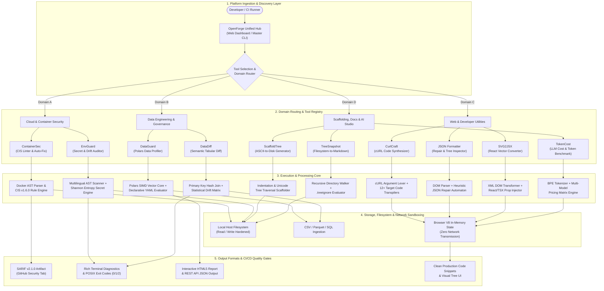
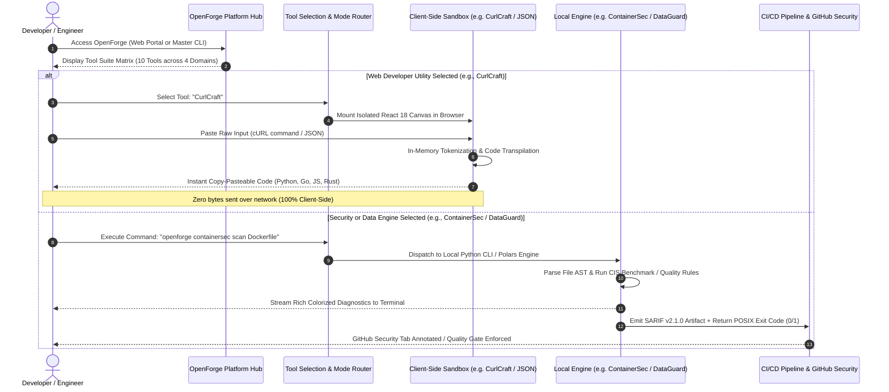

# OpenForge — System Architecture Specification

**Platform:** OpenForge (Unified Open-Source Developer Tools & Engineering Ecosystem)  
**Document Version:** 1.0.0  
**Target Environments:** Local Workstations (CLI / Standalone SPAs), Localhost Microservices, CI/CD Quality Gates  

---

## 1. Executive Architectural Overview

**OpenForge** is a modular, high-performance, developer-first engineering platform designed to consolidate essential cloud security, data engineering, code conversion, scaffolding, and developer productivity tooling into a unified ecosystem.

Traditional developer workflows suffer from fragmented tooling: teams either rely on heavy commercial SaaS platforms (introducing recurring licensing fees and cloud telemetry risks) or unvetted web formatters that expose sensitive data. OpenForge provides a **local-first, zero-telemetry, open-source architecture** comprising 10 decoupled tools accessible via a central launcher and portal.

```
                              ┌────────────────────────────────────────┐
                              │               DEVELOPER                │
                              └───────────────────┬────────────────────┘
                                                  │
                                                  ▼
                        ┌────────────────────────────────────────────────────┐
                        │              OPENFORGE PLATFORM HUB                │
                        │    • Web Developer Portal (Central Dashboard)      │
                        │    • Unified Master CLI (`openforge` / `rosp`)     │
                        └─────────────────────────┬──────────────────────────┘
                                                  │
                 ┌────────────────────────────────┴────────────────────────────────┐
                 ▼                                                                 ▼
   ┌───────────────────────────┐                                     ┌───────────────────────────┐
   │  CLIENT-SIDE SANDBOX SPAs │                                     │   CLI & BACKEND ENGINES   │
   │  • Zero-Network Telemetry │                                     │  • Python 3.8+ / Polars   │
   │  • React 18 + Vite Dev    │                                     │  • FastAPI / Typer / Rich │
   │  • In-Memory Web Workers  │                                     │  • AST Lexers / Compilers │
   └─────────────┬─────────────┘                                     └─────────────┬─────────────┘
                 │                                                                 │
                 └────────────────────────────────┬────────────────────────────────┘
                                                  ▼
                                ┌───────────────────────────────────┐
                                │       ARTIFACTS & QUALITY GATES   │
                                │ • POSIX Exit Codes (0 / 1 / 2)    │
                                │ • GitHub SARIF v2.1.0 Reports     │
                                │ • Rich Terminal UI & HTML Dashboards│
                                └───────────────────────────────────┘
```

### Core Architectural Tenets
1. **Local-First & Zero-Telemetry Privacy**: Web utilities (e.g., JSON Formatter, CurlCraft, SVG2JSX, TokenCost) execute 100% within the browser’s JavaScript V8 runtime. No payloads, tokens, or environment credentials are transmitted over external networks.
2. **High-Throughput Vectorization**: Data quality and diffing pipelines bypass single-threaded Python interpreters in favor of multi-threaded, columnar SIMD execution via Apache Arrow and Polars.
3. **Automated CI/CD Quality Gates**: CLI utilities implement strict POSIX-compliant exit status standards (`0: Clean`, `1: Rule Failure`, `2: Syntax Error`) and emit standard SARIF v2.1.0 payloads for native GitHub Security Tab integration.
4. **Decoupled Modularity**: Every tool exists as an autonomous package with its own virtual environment boundaries, dependencies, and test matrices while adhering to unified OpenForge formatting, logging, and configuration standards.

---

## 2. End-to-End System Architecture

The following diagram illustrates the complete architectural blueprint of OpenForge, beginning with user access at the Platform Hub, routing through domain-specific dispatchers, into core processing engines, and terminating at output artifacts and quality gates:



---

## 3. Layer-by-Layer Architectural Decomposition

### Layer 1: Presentation & User Entry Point
The interface between the developer and OpenForge operates in two complementary modes:
- **OpenForge Web Developer Portal**: A responsive, React 18 single-page application built on Vite and vanilla modern CSS3. It features a catalog of all 10 tools categorized by domain, complete with live search, tool description cards, latency benchmarks, and direct routing. Client-side tools are embedded via isolated iframe sandboxes communicating via `window.postMessage`.
- **OpenForge Master CLI (`openforge` / `rosp`)**: Built with Python’s `typer` and `rich`. Allows direct dispatching of any backend task from developer terminals and CI/CD pipelines (e.g., `openforge containersec scan`, `openforge envguard check`).

### Layer 2: Domain Routing & Dispatcher Layer
When a user selects a tool from the platform, the request is dispatched along one of two isolated execution lifecycles:
1. **Client-Side SPA Dispatch (Zero-Telemetry)**:
   - For: `curlcraft`, `json-formatter`, `svg2jsx`, `tokencost`.
   - The browser runtime mounts a dedicated React application instance.
   - All parsing, transformation, and code generation runs synchronously in local thread memory or via browser Web Workers without external network calls.
2. **Native OS / Microservice Dispatch**:
   - For: `containersec`, `envguard`, `dataguard`, `datadiff`, `ScaffoldTree`, `TreeSnapshot`.
   - The host system runs local Python CLI processes or launches a local asynchronous FastAPI/Uvicorn ASGI microservice (e.g., `envguard ui` on port `8765`, `dataguard api` on port `8000`).

### Layer 3: Core Domain Processing Engines

```
┌────────────────────────────────────────────────────────────────────────┐
│                   OPENFORGE CORE DOMAIN ENGINES                        │
├──────────────────────────┬─────────────────────────────────────────────┤
│ 1. Cloud & Container     │ • CIS Docker Benchmark v1.6.0 AST Engine    │
│    Security Engine       │ • Regex & Shannon Entropy Secret Scanner    │
│                          │ • Dockerfile AST Auto-Hardener (Fix Mode)   │
├──────────────────────────┼─────────────────────────────────────────────┤
│ 2. Vectorized Data       │ • Apache Arrow / Polars Vectorized Core     │
│    Validation Engine     │ • Declarative YAML Quality Rule Evaluator   │
│                          │ • Primary-Key Tabular Diff & Drift Matrix   │
├──────────────────────────┼─────────────────────────────────────────────┤
│ 3. Universal Code &      │ • cURL POSIX Command Tokenizer              │
│    Format Transpilers    │ • 12+ Language Target AST Code Synthesizer  │
│                          │ • Heuristic Fault-Tolerant JSON Repair      │
│                          │ • SVG XML Sanitizer & React Component Gen   │
├──────────────────────────┼─────────────────────────────────────────────┤
│ 4. Filesystem AST &      │ • Unicode/ASCII Hierarchy Tree Parser       │
│    AI Token Engine       │ • Wildcard-Aware Recursive Directory Walker │
│                          │ • BPE Token Estimator & LLM Cost Calculator │
└──────────────────────────┴─────────────────────────────────────────────┘
```

### Layer 4: Storage, Filesystem & Sandbox Security
- **Local Filesystem Isolation**: Server-side tools operate strictly on local file paths. `ScaffoldTree` safely checks for directory presence to avoid destructive overwrites; `TreeSnapshot` enforces `.treeignore` blacklists (`.git`, `node_modules`, `dist`, `__pycache__`).
- **Memory-Only Processing**: Ingested datasets, environment files, and JSON payloads reside transiently in system RAM or browser heap memory and are released upon process exit.

### Layer 5: Output Formats & Quality Gate Integration
OpenForge tools output to industry-standard targets:
- **POSIX Exit Codes**: `0` (Success/Clean), `1` (Violations/Quality Failures), `2` (CLI Syntax/File Missing Error).
- **SARIF v2.1.0 (Static Analysis Results Interchange Format)**: Machine-readable vulnerability output for automated PR comments in GitHub and GitLab.
- **Visual Artifacts**: Standalone, self-contained single-file HTML reports (with embedded charts and filters) and Rich terminal tables.

---

## 4. End-to-End User Interaction Flow

The sequence diagram below walks through a user landing on the OpenForge Platform, selecting a tool, executing an inspection, and exporting outputs into a CI/CD pipeline:



---

## 5. Subsystem Architecture by Domain

### 5.1 Domain A: Cloud & Container Security

#### 1. ContainerSec (`/containersec`)
- **Purpose**: Static security linter and automated remediation engine for container configurations.
- **Architecture**:
  ```
  Dockerfile ──► Pygments Lexer / AST Builder ──► CIS Ruleset v1.6.0
                                                ├── Non-Root User Check
                                                ├── Pinned Base Image Tag
                                                ├── Secret & Credential Regex
                                                └── Healthcheck Directive Check
                                                      │
                       ┌──────────────────────────────┴────────────────────────────┐
                       ▼                                                           ▼
         Hardened Output (AST Rewriter)                           Multi-Format Security Exporters
         "containersec fix" ──► Dockerfile.hardened               ├── Rich Terminal Table
                                                                  ├── SARIF v2.1.0 (GitHub)
                                                                  └── Standalone HTML Report
  ```

#### 2. EnvGuard (`/envguard`)
- **Purpose**: Environment drift governance, multilingual codebase scanner, and secret leakage prevention.
- **Architecture**:
  - **Schema & Drift Auditor**: Compares `.env` against `.env.example` or declarative YAML schemas; detects missing keys and type errors (`port`, `url`, `boolean`, `integer`).
  - **Codebase Scanner (`envguard generate`)**: Multilingual AST scanner (Python, JS/TS, Go, PHP, Ruby, Shell) that extracts accessed environment keys and builds sanitized `.env.example` templates.
  - **Redacted Diff (`envguard diff`)**: Calculates byte lengths and Shannon Entropy for secret values to highlight structural differences without displaying sensitive keys on screen.
  - **Web Dashboard (`envguard ui`)**: FastAPI backend serving a dark-mode SPA on `http://127.0.0.1:8765`.

---

### 5.2 Domain B: Data Engineering & Governance

#### 3. DataGuard (`/dataguard`)
- **Purpose**: Vectorized data quality profiling and constraint validation engine.
- **Architecture**:
  ```
  Input Data (CSV / Parquet / SQL)
                 │
                 ▼
  ┌───────────────────────────────┐
  │   Apache Arrow Columnar Mem   │
  └──────────────┬────────────────┘
                 ▼
  ┌───────────────────────────────┐      Declarative Rules
  │     Polars SIMD Core          │◄──── (YAML Configuration)
  │  - Vectorized Null Bounds     │      - column ranges
  │  - Uniqueness & Regex Sets    │      - enum values
  │  - Statistical Profiler       │      - schema constraints
  └──────────────┬────────────────┘
                 │
                 ▼
  [Reports]: Interactive HTML Dashboard | REST Microservice JSON | POSIX Exit Codes
  ```

#### 4. DataDiff (`/datadiff`)
- **Purpose**: Semantic Git-diff for structured tabular datasets.
- **Architecture**:
  - **Key-Based Record Alignment**: Maps rows by primary key to distinguish between structural row inserts/deletions and in-place field mutations.
  - **Schema Evolution Inspector**: Tracks added/dropped columns and detects datatype changes (e.g., `int32` to `string`).
  - **Statistical Drift Engine**: Computes distribution shifts (mean, standard deviation, null ratio delta) across dataset versions.

---

### 5.3 Domain C: Web & Developer Productivity

#### 5. CurlCraft (`/curlcraft`)
- **Purpose**: Universal cURL to multi-language API code generator.
- **Architecture**:
  - **Lexer & Parser**: Breaks command strings into tokens, supporting multiline escapes (`\`, `` ` ``, `^`), HTTP verbs, query parameters, multipart form data, and authentication flags (`-H`, `-u`, `-d`, `-F`).
  - **Transpiler Targets**: Synthesizes idiomatic code for 12+ runtimes including Fetch, Axios, Python Requests, Python httpx, Go (`net/http`), Rust (`reqwest`), PHP, Java, and C#.
  - **Reactive Inspector**: Two-way state synchronization between the raw cURL input and interactive key-value parameter tables.

#### 6. JSON Formatter & Visualizer (`/json-formatter`)
- **Purpose**: Client-side privacy-first JSON formatter, repair engine, and tree viewer.
- **Architecture**:
  - **Heuristic Error Correction**: Automatically resolves unquoted keys, trailing commas, and single-quoted strings using regular-expression state machines.
  - **Collapsible Virtual Tree**: Renders hierarchical DOM nodes with real-time path extraction (`data.items[2].id`) and schema search filtering.
  - **Cross-Format Exporter**: In-memory serialization to YAML, CSV, and XML.

#### 7. SVG2JSX Studio (`/svg2jsx`)
- **Purpose**: Vector SVG to React component and CSS asset converter.
- **Architecture**:
  - **SVG Sanitization Engine**: Strips doctypes, XML wrappers, editor namespaces (Figma, Illustrator), and hardcoded dimensions.
  - **React Transpiler**: Converts attributes to camelCase (`stroke-width` $\rightarrow$ `strokeWidth`), parameterizes color/size via props, and outputs JSX, TSX, and React Native components.
  - **CSS Generator**: Generates URI-encoded CSS backgrounds and CSS mask rules.

---

### 5.4 Domain D: Scaffolding, Documentation & AI Studio

#### 8. ScaffoldTree (`/ScaffoldTree`)
- **Purpose**: Text/ASCII directory tree to physical filesystem generator.
- **Architecture**:
  - **Parser**: Resolves hierarchy from indentation levels and box-drawing characters (`├──`, `└──`, `│`).
  - **Filesystem Builder**: Uses Python standard library (`pathlib`, `os`) to construct directories (trailing `/`) and files with zero external dependencies.

#### 9. TreeSnapshot (`/TreeSnapshot`)
- **Purpose**: Filesystem-to-Markdown directory tree generator.
- **Architecture**:
  - **Directory Traversal**: Traverses project structures recursively, applying `.treeignore` filters.
  - **Markdown Generator**: Outputs tree diagrams compatible with README documentation and `ScaffoldTree` inputs.

#### 10. TokenCost (`/tokencost`)
- **Purpose**: LLM token counter, multi-model cost benchmark, and prompt variable test bench.
- **Architecture**:
  - **Tokenizer**: Estimates BPE tokens across system, user, and tool-call prompt segments.
  - **Cost Matrix**: Calculates real-time cost projections across 10+ contemporary LLMs (GPT-4o, Claude 3.5 Sonnet, Gemini 2.0 Flash, DeepSeek V3/R1) over standard request volumes (1, 1K, 10K, 1M).
  - **Variable Evaluator**: Dynamically replaces `{{mustache}}` placeholders with sample values and exports ready-to-run SDK code.

---

## 6. Technical Stack Reference

| Subsystem / Tool | Domain | Primary Technologies | Execution Model |
| :--- | :--- | :--- | :--- |
| **OpenForge Hub** | Platform Portal | React 18, Vite, Modern CSS3, Python Typer | Web SPA + Master Terminal CLI |
| **ContainerSec** | Cloud Security | Python 3.8+, Pygments, Rich, Jinja2, SARIF | Local CLI / CI Quality Gate |
| **EnvGuard** | Secret Governance | Python, Typer, Rich, FastAPI, Uvicorn | Local CLI + ASGI Web UI (`:8765`) |
| **DataGuard** | Data Quality | Python, Polars, DuckDB, FastAPI, HTML5 | Vectorized CLI + REST Microservice |
| **DataDiff** | Data Engineering | Python, Polars / DuckDB, Rich | Local CLI / CI Data Quality Gate |
| **CurlCraft** | API Utilities | React 18, Vite, Prism.js | 100% Client-Side In-Memory SPA |
| **JSON Formatter** | Web Utilities | React 18, Vite, Lucide Icons | 100% Client-Side In-Memory SPA |
| **SVG2JSX** | Asset Tooling | React 18, Vite, SVG DOM Parser | 100% Client-Side In-Memory SPA |
| **ScaffoldTree** | Scaffolding | Python 3.8+ (Zero External Dependencies) | Native OS Filesystem Builder |
| **TreeSnapshot** | Documentation | Python 3.8+ (Zero External Dependencies) | Native OS Directory Walker |
| **TokenCost** | AI Engineering | React 18, Vite, Prism.js, BPE Tokenizer | 100% Client-Side In-Memory SPA |

---

## 7. Deployment & Operational Models

OpenForge supports four deployment profiles depending on team requirements:

1. **Standalone Local Workstation**:
   - Python tools installed in editable mode (`pip install -e .`).
   - Web utilities served locally via Vite (`npm run dev`) or accessed as pre-bundled static HTML/JS bundles.
2. **Unified Localhost Platform (Web UI Hub)**:
   - Central portal serves all tools through an integrated interface. Microservice backends (`dataguard`, `envguard ui`) run on local ports (`8000`, `8765`).
3. **CI/CD Quality Gate Runner**:
   - Automated workflows (GitHub Actions, GitLab CI) run tools non-interactively using strict flags (e.g., `containersec scan --fail-on HIGH`, `dataguard validate --fail-on high`, `envguard check --strict`).
   - Reports are exported as SARIF v2.1.0 or JSON files to fail PR checks when vulnerabilities or drifts are detected.
4. **Isolated Dockerized Services**:
   - Containerized services expose API endpoints for team-internal data validation and security scanning behind private VPNs.
